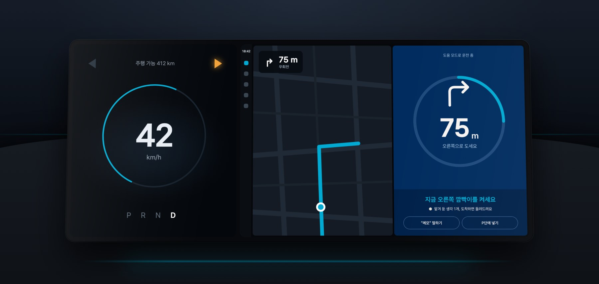
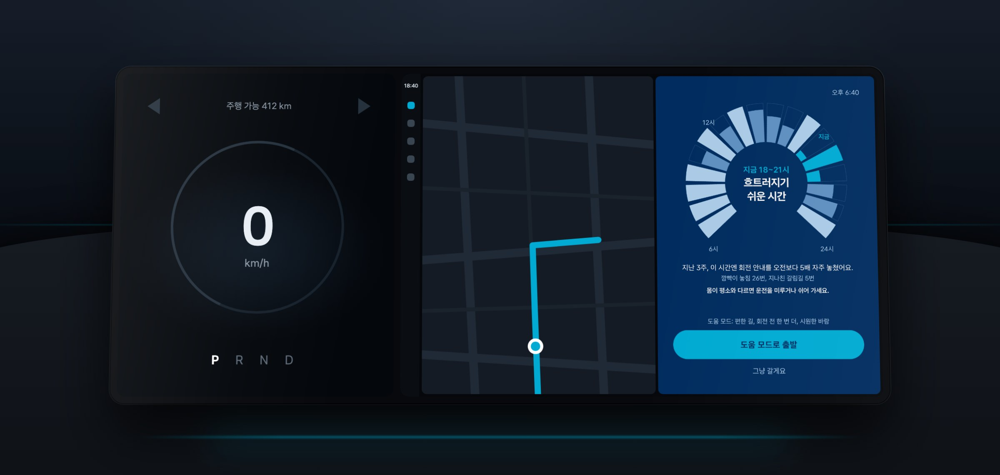
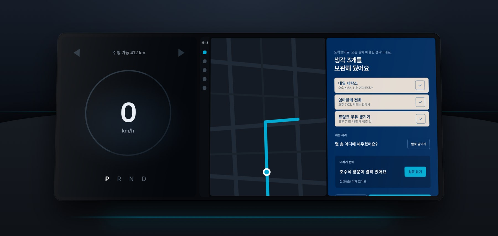
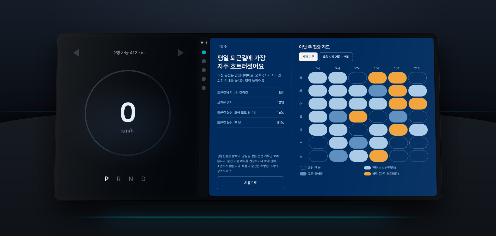
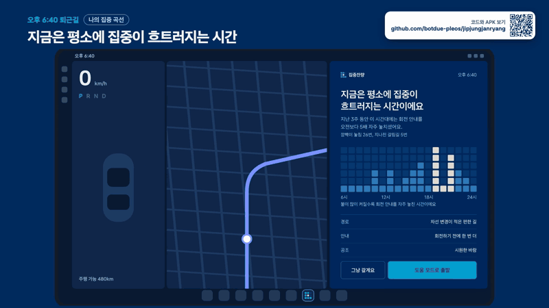
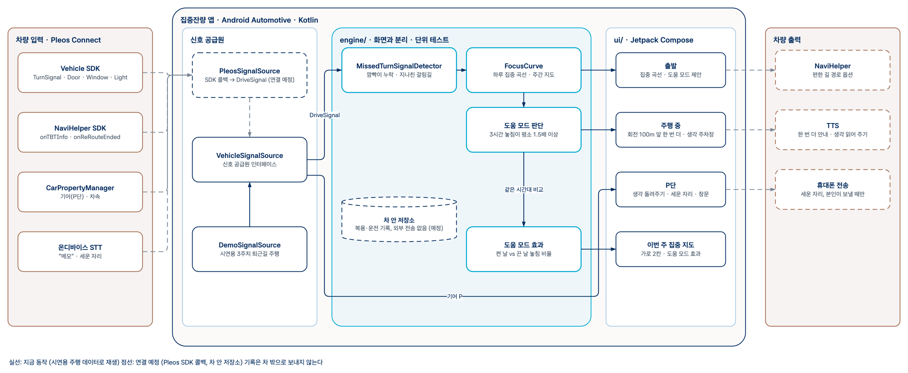
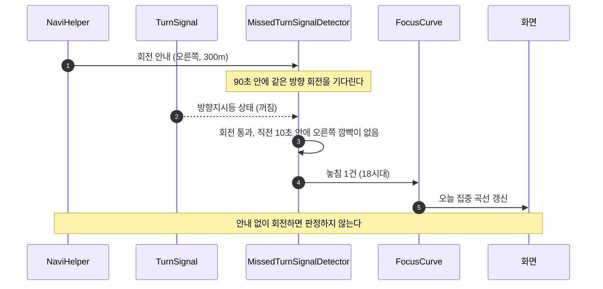

<div align="center">

# 집중잔량

**내 운전으로 찾은 집중 시간대, 그 시간엔 차가 덜어준다.**

성인 ADHD 운전자를 위한 Pleos Connect 차량 앱




[움직이는 장면](#움직이는-장면) · [**시연 영상 (60초)**](docs/demo.mp4) · [APK 받기](apk/봇듀_집중잔량_release.apk) · [개발일지](docs/개발일지.md) · [시스템 구조](#시스템-구조)

</div>

> [!NOTE]
> 2026 현대자동차그룹 차량용 앱 개발 공모전 "Code your App into Pleos App Market" 출품작, 팀 봇듀.
> 차량 신호는 아직 시연용 3주치 주행 데이터로 재생한다. Pleos SDK 콜백 연결은 [현재 상태](#현재-상태)에 적었다.

## 한눈에 보기

| | |
| --- | --- |
| 누구를 위해 | 시간대에 따라 집중이 크게 달라지는 성인 ADHD 운전자 |
| 무엇을 보나 | 내비 회전 안내 대비 깜빡이 누락, 안내받고 지나친 갈림길 |
| 무엇을 해 주나 | 흐트러지는 시간대에만 안내를 한 번 더, 떠오른 생각은 말로 맡아 두었다가 P단에서 돌려준다 |
| 무엇을 하지 않나 | 점수·진단·약효 예측. 남과 비교하지 않고 본인 기록 안에서만 본다 |
| 데이터 | 차 안에만 저장. 밖으로 보내지 않는다 |

## 차 안에서 이렇게 보인다

<table>
<tr>
<td width="50%"></td>
<td width="50%"></td>
</tr>
<tr>
<td><b>출발</b><br>하루 집중 곡선을 충전 칸으로 보여 주고, 지금이 평소 흐트러지는 시간이면 도움 모드를 제안한다</td>
<td><b>주행 중</b><br>회전 100m 앞에서 한 번 더 안내. "메모"라고 말하면 생각을 맡아 둔다</td>
</tr>
<tr>
<td></td>
<td></td>
</tr>
<tr>
<td><b>P단에 넣으면</b><br>맡아 둔 생각과 세운 자리를 돌려주고, 열린 창문까지 확인한다</td>
<td><b>이번 주 집중 지도</b> (가로 2칸)<br>요일 × 시간대, 약 먹은 시각 기준으로도 본다</td>
</tr>
</table>

<sub>앱 화면은 Pleos Connect 앱 창 크기(세로 1칸 920×1330, 가로 2칸 1870×1330) 에뮬레이터에서 찍은 실제 실행 화면이다. 둘레의 운전석과 계기판은 설명을 위해 그린 가상 목업이다.</sub>

### 움직이는 장면

<table>
<tr>
<td width="45%"></td>
<td>
<b>저녁 퇴근길 (15초)</b><br><br>
1. 출발: 지금부터 3시간이 충전 칸이 적은 시간이라 도움 모드를 권한다.<br>
2. 주행: 회전 100m 앞에서 "지금 오른쪽 깜빡이를 켜세요". 떠오른 생각은 "메모"라고 말해 맡긴다.<br>
3. P단: 맡긴 생각을 모래색 카드로 돌려주고, 열린 창문을 알려 준다.<br><br>
<sub>에뮬레이터 실제 화면(v0.4.0)을 녹화했다.</sub>
</td>
</tr>
</table>

## 왜 만들었나

| 사실 | 출처 |
| --- | --- |
| 20세 이상 ADHD 진료 인원 2020년 2만 5,297명에서 2024년 12만 2,614명으로 4.85배 | 국민건강보험공단 자료, 국회 남인순 의원실 분석 ([헤럴드경제 2025.10.07](https://www.heraldk.com/article/2025100722425224371)) |
| ADHD 약을 먹은 달에는 운전 사고 위험이 남성 38%, 여성 42% 낮았다 | Chang et al., JAMA Psychiatry 2017. 미국 건강보험 청구자료 230만 명 분석 |

같은 사람도 시간대에 따라 집중이 다르다. 퇴근길은 아침에 먹은 약의 효과가 떨어지는 시간과 겹치기 쉬운데, 본인도 언제 흐트러지는지 객관적으로 알 방법이 없다. 휴대폰 운전 모드는 알림만 막고, 약효 추적 앱은 실제 운전 행동을 보지 않는다.

> [!TIP]
> **왜 휴대폰이 아니라 차여야 하나.** 깜빡이, 회전 안내, 기어 같은 흐트러짐의 증거는 차 안에서만 정확히 잡힌다. 생각 주차장은 기어 상태를 아는 차만 안전한 순간(P단)에 돌려줄 수 있다.

## 무엇을 하나

| 기능 | 내용 |
| --- | --- |
| 나의 집중 곡선 | 회전 안내 대비 깜빡이 누락과 지나친 갈림길을 시간대별로 모아 "언제 흐트러지는지"를 보여준다 |
| 도움 모드 | 평소 흐트러지는 시간에 출발하면 먼저 알리고, 동의하면 회전 100m 앞에서 한 번 더 안내한다 |
| 생각 주차장 | 운전 중 떠오른 생각은 "메모"라고 말하면 보관한다. 주행 중 화면에는 아무것도 띄우지 않는다 |
| P단에서 돌려주기 | 주차하면 보관한 생각을 하나씩 돌려주고, 창문과 전조등까지 확인한다 |
| 세운 자리 남기기 | 주차하면 "몇 층 어디에 세우셨어요?"라고 묻고 말로 남긴다. 휴대폰으로는 본인이 보낼 때만 |
| 이번 주 집중 지도 | 요일과 시간대별 집중 상태. 약 먹은 시각 기준으로도 볼 수 있다 |
| 도움 모드 효과 | 같은 퇴근길에서 도움 모드를 켠 날과 끈 날의 놓침 비율을 나란히 보여준다 |

약효를 추정하지 않는다. 실제로 관찰된 운전 패턴만 보여준다.

## 디자인

현대차 아이오닉 5 단편 광고 "밤낚시"(칸 라이언즈 2025 그랑프리)의 밤 충전소에서 출발했다. 이 광고에는 차가 나오지 않고 사람만 나오며, 장면 전체가 차의 카메라 시선이다. 집중잔량도 차 데이터보다 운전자의 시간과 생각을 앞에 둔다.

- **집중을 충전 칸으로**: 하루 집중 곡선은 6시~24시 막대 18개, 막대마다 6칸이다. 그 시간에 회전 안내를 잘 따랐을수록 칸이 많이 찬다. 지금부터 3시간만 충전 빛(Active Blue)으로 칠한다.
- **모래색은 생각에만**: 운전 중 맡겨 둔 생각은 P단에서 모래색 카드로 돌려준다. 차가 알려 주는 정보(창문·전조등)는 남색 카드로 구분한다.
- **이번 주 집중 지도**: 자주 흐트러진 칸은 빈 충전 칸처럼 테두리만 남긴다.
- 색은 Hyundai Blue보다 한 단계 깊은 밤 남색 바탕에 현대차 CI의 Active Blue·Sky Blue·Sand, 서체는 Pleos 공식 Asta Sans.

## 시스템 구조

차량 신호는 하나의 공급원(`VehicleSignalSource`)으로 모이고, 판정은 화면과 분리된 엔진이 한다. 시연용 데이터와 실제 Pleos SDK를 같은 인터페이스로 바꿔 끼우므로 엔진과 화면은 그대로 쓴다. 점선은 아직 연결 전인 부분이다.



<sub>diagrams.net으로 그렸다. 원본 <a href="docs/architecture.drawio">docs/architecture.drawio</a>는 <a href="https://app.diagrams.net">app.diagrams.net</a>에서 파일 › 열기로 바로 고칠 수 있다.</sub>

### 깜빡이 누락은 이렇게 판정한다



<details>
<summary><b>폴더 구조</b></summary>

```
app/src/main/java/com/botdue/jipjung/
├── engine/                        판정 엔진 (화면과 분리, 단위 테스트 대상)
│   ├── DriveSignal.kt             차량 신호 모델: 회전 안내, 방향지시등, 회전 통과, 경로 재탐색
│   ├── MissedTurnSignalDetector   깜빡이 누락과 지나친 갈림길 판정
│   ├── FocusCurve.kt              하루 집중 곡선, 도움 모드 판단과 효과, 주간 지도
│   └── VehicleSignalSource.kt     신호 공급원 인터페이스와 시연용 데이터
├── ui/                            Jetpack Compose 화면 (현대차 CI 색, Asta Sans, 주간·야간)
└── MainActivity.kt                화면 흐름
```

</details>

<details>
<summary><b>Pleos SDK 연결 계획</b></summary>

| 신호 | API |
| --- | --- |
| 방향지시등 | `TurnSignal.registerTurnSignalState()` |
| 회전 안내, 경로 재탐색, 편한 길 | `NaviHelperEventListener.onTBTInfo()`, `onReRouteEnded()`, `changeRouteOption(COMFORTABLE)` |
| 문, 창문, 전조등 | `Door.registerDoorPosition()`, `Window.registerWindowPosition()`, `Light.registerLowBeamLightState()` |
| 기어(P단), 차속 | AAOS `CarPropertyManager` (GEAR_SELECTION, PERF_VEHICLE_SPEED) |
| 생각 주차장, 세운 자리 | ON_DEVICE STT, TTS |

`VehicleSignalSource` 를 구현한 `PleosSignalSource` 를 추가하면 화면과 엔진은 그대로 쓴다.

</details>

## 판정 규칙

판정은 엔진(`app/src/main/java/com/botdue/jipjung/engine/`)이 한다. 모든 규칙에 단위 테스트가 있다.

1. **깜빡이 누락**: 내비가 회전을 안내하고(`NaviHelper onTBTInfo`) 90초 안에 같은 방향으로 회전했을 때, 회전 직전 10초 안에 같은 방향 깜빡이(`Vehicle TurnSignal`)가 켜지지 않았으면 놓침. 안내 없는 회전은 판정하지 않는다.
2. **지나친 갈림길**: 회전 안내 후 90초 안에 회전하지 않고 경로를 다시 찾으면(`onReRouteEnded`) 지나침. 깜빡이 놓침과 함께 흐트러진 회전으로 센다. 안내 없는 재탐색은 세지 않는다.
3. **하루 집중 곡선**: 6시부터 24시까지 1시간 단위 놓침 비율. 본인 기록 안에서만 비교하고, 남과 비교하거나 점수로 판정하지 않는다.
4. **도움 모드 제안**: 지금부터 3시간의 놓침 비율이 본인 평소의 1.5배 이상이면 "흐트러지는 시간"으로 보고 출발할 때 알린다.
5. **주간 지도**: 요일 x 시간대 6칸. 놓침 15% 미만은 안정적, 30% 이상은 자주 흐트러짐.
6. **도움 모드 효과**: 같은 시간대(퇴근길 18~21시)에서 도움 모드를 켠 날과 끈 날의 놓침 비율을 따로 센다. 원인을 추정하지 않고 관찰된 비율만 견준다. 시연 데이터는 켠 날 놓침을 낮게 가정해 만든 것이다.

## 실행

```bash
adb install apk/봇듀_집중잔량_release.apk   # Pleos Connect Emulator(AAOS)
./gradlew :app:testDebugUnitTest            # 판정 엔진 테스트 19개
./gradlew :app:assembleRelease              # APK 빌드 (JDK 17)
```

시연 시나리오는 저녁 퇴근길(오후 6시 40분 출발)이다. 주행 화면의 "메모 말하기"가 음성 인식을, "P단에 넣기"가 기어 신호를 대신한다.

원하는 화면에서 바로 열기(화면 캡처·영상용):

```bash
adb shell am start -n com.botdue.jipjung/.MainActivity --es screen Parked --ei memos 3   # Depart · Driving · Parked · Weekly
```

## 현재 상태

- [x] 화면 4종과 판정 엔진, 단위 테스트 6개 (v0.1.0)
- [x] 지나친 갈림길 판정, 도움 모드 판단 엔진 이동, 테스트 16개 (v0.2.0)
- [x] 세운 자리 남기기, 도움 모드 효과 비교, 테스트 19개 (v0.3.0)
- [x] Pleos 앱 창 크기 에뮬레이터에서 동작 확인, 시연 영상
- [x] 디자인 "밤 충전소": 충전 칸 곡선, 생각 카드, 빈 충전 칸 지도 (v0.4.0)
- [x] 시연 영상 v6: v0.4.0 화면으로 다시 녹화
- [ ] Pleos Connect Emulator에서 SDK 콜백 연결 (`PleosSignalSource`)
- [ ] 생각 주차장·세운 자리 STT·TTS, 휴대폰 전송 방식 확인, 내리기 전 확인 실제 신호, 로컬 DB 저장
- [ ] 도움 모드 경로 옵션·공조 제어, 시연용 주행 데이터 재생 도구 (2차 PT용)

자세한 진행은 [개발일지](docs/개발일지.md)에 있다.

## 원칙

> [!IMPORTANT]
> - 복용·운전 기록은 차 안에만 저장하고 밖으로 보내지 않는다.
> - 운전 습관을 보여줄 뿐 의학적 진단이나 약효 예측이 아니다.
> - ADHD를 고쳐야 할 결함이 아니라 차가 맞춰주는 특성으로 다룬다.

## 라이선스

글꼴 Asta Sans: SIL Open Font License 1.1
